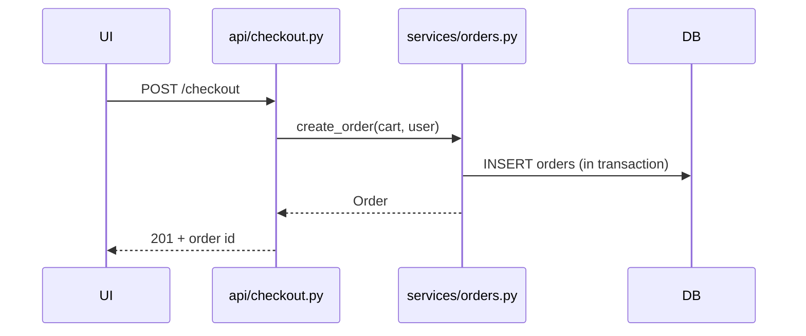

# Explain Code

Explain what the code actually does, verified by reading and, where possible,
by running it, at the depth the reader needs. Names lie, comments drift and
configuration changes behaviour; the explanation must follow the real path.

Usage: `/explain-code <file | symbol | feature | flow> [quick|standard|deep]`.

## When to use

- "What does this do?", "walk me through the checkout flow", "why is this written like this?".
- Before modifying unfamiliar code, reviewing a PR in an unknown area, or handing code over.
- Producing a walkthrough artifact for onboarding or documentation.

## When not to use

- Mapping a whole repository: `/codebase-onboard` (then come back for specific flows).
- Something is broken and you need the cause: `/root-cause`.
- Judging whether a change is correct: `/code-review`.

## Workflow

1. **Pin the target, reader and depth.** Quick: summary plus the key lines. Standard: walkthrough plus one diagram. Deep: full trace, data flow, history, gotchas and how to change it safely. Default to standard. Note the reader (new hire, reviewer, non-engineer).

   **Check:** Target, depth and reader are stated at the top of the artifact.

2. **Find the entry points.** Use `grep_search` for the symbol, route strings, CLI command names, event or queue names, and tests that exercise it. For large or unknown repos, delegate a scoped scan to the `codebase-explorer` subagent with the target and ask for entry points and key files only.

   **Check:** You can name the entry point as `path:line` and how it is triggered (HTTP route, CLI, cron, event, UI action).

3. **Trace the execution path.** Follow each call with `view_file`, recording `path:line` per hop. Watch for indirection that names hide: dependency injection, middleware and decorators, dynamic dispatch, reflection, generated code, feature flags and configuration, async boundaries (queues, callbacks, promises, goroutines). Dependency graph tools help on larger modules:

   ```bash
   npx madge --circular --extensions ts src/     # JS/TS import cycles
   npx madge --image graph.svg src/              # needs Graphviz installed
   go list -deps ./cmd/server                    # Go package dependencies
   cargo tree                                    # Rust crate graph
   ```

   **Check:** Every hop in the walkthrough was read, not inferred from a function name.

4. **Map data and state.** Inputs (shape and source), transformations, outputs, persistence (tables, files, caches), side effects (network, global state, metrics, emails), and error paths: what is caught, retried, swallowed or surfaced.

   **Check:** Each side effect and each error path is listed with its location.

5. **Confirm by running.** Run the existing tests that cover the path, or a small script, REPL call or temporary log line in a scratch branch. Revert any temporary instrumentation. Ask before running anything that touches shared databases, external services or real users.

   **Check:** At least one key claim is confirmed by execution, or the artifact marks the explanation "read-only, unverified".

6. **Recover the why.** History explains intent that code cannot:

   ```bash
   git log -L :functionName:path/to/file.ts      # evolution of one function
   git blame -w -C -C path/to/file.ts            # ignore whitespace, follow moved code
   git log --follow --oneline -- path/to/file.ts
   ```

   Read the linked PRs, issues and ADRs for the commits that introduced odd-looking code.

   **Check:** Each "this looks wrong" item is explained by history or marked as an open question.

7. **Write the walkthrough artifact** in the format below. Tune vocabulary to the reader; for non-engineers drop file paths into a footnote list and keep the diagram.

   **Check:** Every claim cites `path:line`; unknowns are listed, not guessed.

## Output format

````markdown
# How <feature/flow> works
**Depth:** standard · **Reader:** new backend engineer · **Verified:** tests in `orders/test_checkout.py` pass

## TL;DR
<three to five sentences>

## Map


## Walkthrough
1. `api/checkout.py:42` validates the cart and ...
2. `services/orders.py:88` opens a transaction and ...

## Data and side effects
| What | Where | Notes |

## Gotchas
- <surprising behaviour, with path:line and why it exists>

## Changing it safely
- Tests to run: ... · Contracts to keep: ... · Risky areas: ...

## Open questions
- <what could not be determined, and how to find out>
````

Mermaid renders in many Markdown viewers; if it does not render where the user reads, keep it as a code block, which still reads as text.

## Anti-patterns

| Don't | Do instead | Why |
| :--- | :--- | :--- |
| Explain from names and comments | Read every hop; verify by running | Names and comments drift from behaviour |
| Paraphrase line by line | Explain intent, flow and consequences | Readers can read the code; they need the model |
| Ignore config, flags and middleware | Trace them explicitly | They often decide the real behaviour |
| Draw a 40-node diagram | One diagram per question, under ~12 nodes | Big diagrams explain nothing |
| Leave instrumentation behind | Use a scratch branch and revert | Explanation must not change the code |

## Verification checklist

- [ ] Target, depth and reader stated.
- [ ] Entry point and every hop cited as `path:line`.
- [ ] Data flow, side effects and error paths listed.
- [ ] At least one claim verified by running, or marked unverified.
- [ ] History consulted for surprising code.
- [ ] Temporary changes reverted; open questions listed.

## Related

- Workflows: `/codebase-onboard`, `/root-cause`, `/code-review`.
- Knowledge: `documentation-writing`, `knowledge-management`, `legacy-modernization`, `git-workflow`.
- Agents: `codebase-explorer`, `code-architect`.
